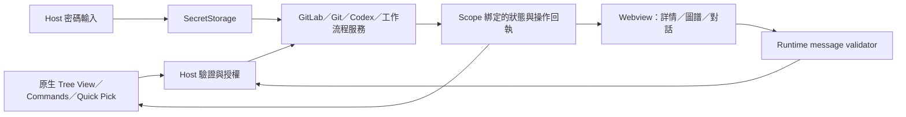

# GitLab Workspace：UI/UX 改善與實作方案

先完成四個 P1 修正，再進行原生 UI 分工。保留現有 Preact／Vite、Host service、操作回執、Repo scope、Git 與工作流程能力；將原生 Settings、Quick Pick、Tree View 用在適合的任務入口與資料導覽。對應問題與實測限制見 [審查報告](review.md)。

實作維持 `engines.vscode: ^1.90.0` 的公開 API 邊界；新能力須確認最低版本或提供 feature detection，不使用 `src/vs/*`、內部 Accessible View 等 Workbench API。

## UI surface decision matrix

| 使用者任務 | 現況 | 建議 surface | 選擇理由／取捨 |
| --- | --- | --- | --- |
| 瀏覽工作區與 Repo | Webview 自繪 Repo 列表 | 原生 `TreeView`；大型專案選取／批次結果可留 Panel | 借用鍵盤、focus、context menu 與工作區整合；避免重做所有列表機制 |
| 瀏覽我的 Issue／待審查 MR | 工作台列表與詳情 | 精簡原生資料 View＋現有 Webview 詳情；工作台列表可保留大量篩選用途 | Tree node 代表資料，點擊開啟該項詳情；複雜表單與 rich content 有 Webview 理由 |
| 單次選 Workspace／Repo／Group／帳號 | Webview 下拉、部分原生選取 | `showQuickPick`；詳情中保留必要的目前目標摘要 | 原生可搜尋、可取消；複雜資料呈現不塞進 Quick Pick |
| 站台網址／PAT | Webview 兩步登入 | `showInputBox`；PAT `password: true` | 使用 Host-only 機密輸入；登入後只推送安全摘要 |
| Extension 持久設定 | Settings contribution＋自訂設定抽屜 | 原生 Settings，導向精確 ID | 統一 User／Workspace／Folder scope 與搜尋位置 |
| WorkflowKit 安裝／相容性／環境診斷 | 設定抽屜 | 現有 Panel 中「工具與環境」任務詳情 | 安裝進度、版本差異與復原是任務狀態；持久值連到原生設定 |
| 基本 Git 檔案／Diff | 自訂 Git 工作台與原生 Diff 入口 | 原生 SCM／Diff 為快捷路徑；保留進階圖形工作台 | 既有 Commit graph、部分行暫存與 Rebase 能力需維持；逐項確認原生功能足以承接後才搬移 |
| Issue 圖譜／複雜關聯／Markdown | Webview | 保留 Webview Panel | 公開原生 View 無法完整呈現圖譜及 rich document |
| Codex 對話／工具表單／核准 | 工作台底部 Webview 區 | 保留；提供任務摘要與明確跳轉、可調整大小 | Rich transcript 與結構化互動有必要；避免自動展開後壓縮主要內容到不可用 |
| 啟動／更新／取消等命令 | Palette＋側欄按鈕 | Command／view toolbar／context menu | 動作不使用假 Tree node；常用操作可由鍵盤獨立啟動 |
| 操作進度／錯誤 | Inline、snackbar、訊息中心 | 以任務內進度為主；背景必要事件才用原生通知 | 保留操作紀錄與回執，降低重複提示；通知需有明確下一步 |
| 跨頁執行狀態 | 工作台 footer | 視需要提供單一原生 Status Bar item | 只有離開工作台仍須掌握的任務／待核准狀態值得常駐 |
| 日誌 | 原生 Output Channel | 保留 | 原生日誌搜尋、複製與等級管理已合適 |

此分工依官方 [Views](https://code.visualstudio.com/api/ux-guidelines/views)、[Webviews](https://code.visualstudio.com/api/ux-guidelines/webviews)、[Settings](https://code.visualstudio.com/api/ux-guidelines/settings) 及 [Notifications](https://code.visualstudio.com/api/ux-guidelines/notifications)。不增加新的 Activity Bar Container；調整現有 Container 即可。

## 資訊架構與資料流

既有 GitLab Workspace Container 最多先規劃兩個資料 View：「專案」與「我的工作」。前者依 WorkspaceFolder／Repo 展示，後者依目前帳號列 Issue／MR，必要時加入具明確 Repo identity 的任務。分析、BMAD、設定、刷新與掃描屬於 commands／toolbar／Welcome links。原生 View 的新增數量應以實際必要性驗收，避免把目前 6 個入口各拆成一個 View。

工作台仍承接 Dashboard、Issue／MR 詳情、Skills／BMAD、Git 圖譜及 Codex 對話。頁首顯示目前目標與必要操作；技術版本、完整 SHA、安裝診斷放可展開的細節。每個任務一個 primary：例如 Skills／BMAD 以「使用 Codex 執行」為主，「複製提示詞」為 secondary。

任務 identity 沿用並補足 Host 權威值：account／connection epoch、WorkspaceFolder URI、Repo root URI／ID、task ID。工作目標以 URI 與確認過的 Repo 為準；不得因 active editor、CWD 或使用者切換畫面而改變既有任務目標。全域 Codex 任務紀錄與目前可存取的工作區目標分開呈現，scope 不可驗證時禁止相關寫入。

## 使用者路徑與狀態契約

| 路徑 | 入口／主要步驟 | 狀態與復原 |
| --- | --- | --- |
| 首次使用／離線工作 | 開啟 Container → Repo 資料；空白時「開啟資料夾」／「掃描 Repo」 | 不強迫 GitLab 登入；未偵測 Repo、Git 停用、掃描中／取消／部分結果／錯誤分別描述，保留已找到的資料 |
| GitLab 登入 | 帳號 Quick Pick → URL Input Box → PAT password Input Box → 驗證 → Group | 每步 Escape 可取消；驗證失敗保留原帳號、已保存的秘密不回送 UI；未授權／過期提供重新登入；網路暫不可用保留可讀快取 |
| 閱讀／處理 Issue | 工作資料 View／Palette → Issue 詳情 → 編輯／討論／關聯／工時 | Loading、confirmed empty、partial、unsupported、permission unknown／denied 清楚區分；發送失敗保留草稿；結果 unknown 先核對 |
| 審查 MR | 選 MR → 變更／討論 → 按需檢查分支 → 確認 Repo、base、head → 執行審查 | SHA 未確認時禁止需要固定版本的操作；GitLab 不能讀取時顯示快取與時間；核准／合併依 Host 重新驗權及原生確認 |
| Git 操作 | 選 Repo → 變更／Diff → 暫存／Commit；進階操作從選單開啟 | 明示 Repo／branch／staged scope；危險操作使用原有 Host 確認；取消、衝突、部分成功、refresh failure、unknown 各有明確下一步 |
| Skills／BMAD | 選定工具與目標 → 輸入需求 → 使用 Codex 執行 | 未安裝／版本不明／能力不足／唯讀工作區有可操作原因；複製、執行、產物觀察與完整交付狀態分別顯示 |
| Codex 對話 | 選任務 → 輸入補充 → 送出／等待互動 → 結果／續作 | queued／starting／running／waiting／completed／failed／interrupted／uncertain 沿用；草稿依 task 保存；blocked 不清空；unknown 不自動重送 |
| 工作區移除／切換 | 原生資料 View 更新；任務仍綁定原 identity | 顯示「原工作區目前不可存取」；拒絕舊 scope 寫入；可讀歷史／複製內容／重新選擇目標後建立新任務 |
| Restricted／Virtual／Remote | 原生 Welcome／狀態說明顯示目前能力 | 沿用 untrusted unsupported 與 virtual limited；Remote SSH／WSL 需另查 URI／Host 位置，不將它們直接宣稱為已支援的本機路徑 |

正式產品若沒有 Demo 功能，無須新增 Demo 狀態；測試 fixture 必須繼續明確標示其測試用途。已登入與即時網路可達性應分開描述，快取資料保留時間與來源標示。

## 分批實作與可驗收條件

### A：草稿與 Host 邊界（F01／F04／F07）

預期修改：

- `src/webview/CodexPanel.tsx`：依任務保存草稿、回傳／處理 dispatch 結果、以 operation ID 對帳，補摘要與跳轉。
- `src/webview/dashboard.tsx`／`src/webview/domainActions.ts`：重用既有 action context、receipt 與保存機制；避免新增另一套成功判斷。
- `src/workspace/workspaceProtocol.ts` 與新增純函式 validator：完整 discriminated union runtime schema；與 TS 型別保持一致，未知 type／欄位預設拒絕。
- `src/workspace/workspacePanel.ts`：在 `handleOperationMessage` 最前方驗證，合格後才執行 policy／service；保留各 service 的 identity／授權檢查。
- `test/unit/`／`test/behavior/`：僅補充有使用者風險的回歸情境。

驗收：

1. A／B 任務切換後各自草稿完整；取消、重開 Webview 後依既有保存政策還原。
2. blocked／failed／unknown／Host reload 保留未被確認的文字；不得自動重送。
3. 成功回執只清除該次提交的原文字，不清除使用者後來輸入的新文字。
4. F04 兩個 malformed payload 在 adapter 前被拒絕；所有 message variants 具合法／錯誤型別／過長／未知欄位／跨 scope 的測試，無任何 service 副作用。
5. 新互動會產生一次有意義的 polite 摘要；提供「前往待回覆要求」，顯示 Repo＋action＋scope。串流不逐字朗讀；背景任務不自動轉移編輯器焦點。

### B：可讀性、窄寬度與共同互動元件（F02／F03／F06／F11）

預期修改：

- `GitControlPanel.tsx`／`git-control-panel.css`：選單碰撞處理、Escape／焦點還原、Diff tokens、狹窄布局與適當密度。
- 新增共用 Tabs 元件；套用至 `dashboard.tsx`、`main.tsx`，再檢查 Skills／BMAD 一致性。
- `dashboard.css`、`quick-actions.css`、`style.css` 與各功能樣式：共同字級、輸入／按鈕／focus／高對比規則。
- `SkillsGuide.tsx`、`BmadPanel.tsx`：一個 primary；調整一般條件提示的位置與顯示層級。

驗收：

1. 側欄 240／320px；Panel 480／640／960／1280px；多語長標題／路徑均可操作。所有實際開啟的選單保持在 viewport，無裁切的主要操作。
2. Light／Dark／HC／HC Light 的 Diff、表單、按鈕、選取及 focus 皆清楚；一般有效資訊文字依 AA 4.5:1、非文字控件依適用標準檢查。禁用／裝飾文字依標準例外處理，不能把所有像素機械判成失敗。
3. 真實 VS Code 125%／200% zoom 下沒有消失的操作或重疊；viewport 縮小僅作前置檢查。
4. Tabs 的 ID／`aria-controls`／panel label 完整；Tab／Shift+Tab、方向鍵、Enter／Space、Home／End 行為一致。
5. 選單／對話框關閉後回到觸發元素；可用原生 HTML 語意就使用原生元件，不採用已封存的 Webview UI Toolkit。
6. F02 重跑不再有 x = −142px 的選單；F03 的固定 hunk 色被合適 theme token 取代，實際主題量測通過。

### C：原生設定與帳號入口（F05／F08／F10）

預期修改：

- `src/extension.ts`：以一致的 command category／動詞註冊入口；修正無參數 Issue 命令的使用者路徑。
- `package.json`：精簡 commandPalette 可見性、補 view menu／when／enablement；持久設定保留清楚預設與 scope。
- Host 新增帳號登入 controller，重用 `accountStore` 與 `session.connect()`；URL 與 PAT 在原生 Input Box 取得。
- `AccountPanel.tsx`：保留帳號摘要與管理意圖；移除 Token state、DOM、Token payload 與多步 wizard。
- `dashboard.tsx`／`workspacePanel.ts`：將持久設定導向 `workbench.action.openSettings` 的精確 ID；安裝／診斷詳情改名「工具與環境」。

驗收：

1. Webview HTML、state、localStorage、log、Host→Webview 及 Webview→Host 訊息均沒有 PAT；SecretStorage 仍是唯一持久化位置。
2. 新增／切換／重新登入／登出／移除與各步取消，保留現有帳號及草稿規則；網路失敗不覆寫原憑證。
3. Palette 每個可見命令在沒有 context 參數時均有結果或明確下一步；context-only 命令不出現在 Palette。
4. 根目錄、Codex 執行檔及其他既有設定從同一原生 Settings 可找到；Folder／Workspace／User scope 清楚。安裝過程、版本相容性與進行中任務保持可見及可取消。
5. 保留舊 command ID／非敏感設定相容性；Token message 的移除與前後端 bundle 同版更新，避免留下可被舊 UI 調用的秘密通道。

### D：側欄資料導覽原生化（F09／F11）

預期修改：

- `package.json`：在既有 Container 改用精簡 Tree View、view title actions、context menu 與 `viewsWelcome`。
- 新增 `TreeDataProvider`／controller，重用現有 Git Repo、Issue／MR cache 與 operation summary；不讓 render 或展開列表觸發額外遠端輪詢。
- `extension.ts`：註冊 native View、原生命令與目前目標；使用 `ThemeIcon`／本地 Codicons。
- `quickActionsView.ts`／`quick-actions.*`／sidebar Vite 設定及相關測試：在新路徑達到功能同等後分步退役；遷移前保留可以回復的版本差異。

驗收：

1. Tree item 代表真實資料，不把各功能動作做成假資料列。每項行內動作控制在官方建議範圍，其餘放 context menu。
2. Repo 身分能分辨同名、不同 root、worktree／submodule；Folder 移除後不切換到另一個 Repo 執行原任務。
3. 原生 View 可移到 Secondary Sidebar／Panel；空白、載入、失敗、離線／快取均有清楚文字與下一步。
4. 以方向鍵探索 Repo、Enter 開啟資料詳情、Shift+F10 顯示 context menu；主要動作也能從 Palette 執行。
5. 大量 Repo／Issue／MR、分頁、取消、恢復與 network budget 維持原政策；切換 View 不產生背景刷新風暴。

### E：原生 Host 與讀屏驗收

實作以上批次後，執行 `npm.cmd test`，依各變更加入必要回歸情境。瀏覽器 probe 僅作重現與對比；使用實際 F5 Host 完成以下人工驗收：

| 場景 | 通過條件 |
| --- | --- |
| 純鍵盤主要任務 | 開 View → 選 Repo → 開 Issue／MR → 輸入／送出 → 查看結果 → 關閉並回編輯器，全程焦點清楚 |
| NVDA | 標籤、tab／panel、狀態、錯誤與核准順序正確；完整回覆可讀，串流不持續插話 |
| 四類主題與 zoom | Light／Dark／HC／HC Light；125%／200%；sidebar 與 split editor 均能完成主要操作 |
| 工作區生命週期 | Empty、單根、多根、Folder 移除、切換帳號／Group、hide／dispose／reload／Host restart 不跨 scope、不遺失未提交草稿 |
| GitLab 故障與權限 | 無帳號、過期、403、離線、限流、部分結果與 unknown write；保留資料並提供合理復原 |
| Git／Codex | 正常／失敗／衝突／取消／等待核准；Repo／action／scope 始終明確，不重送不確定的寫入 |
| Workspace 能力 | Restricted Mode 與 virtual limited 的宣告符合實際能力；SSH／WSL／Remote 的測試結果與支援限制如實記錄 |
| 安全性 | 惡意 HTML／URL、未知與超長訊息、跨 Repo ID、舊 scope／Host session、secret redaction；拒絕前無副作用 |

目前單一 symlink 測試仍受 Windows `EPERM` 限制；應在可建立測試連結的隔離環境補跑。完整驗收前保留 `NOT TESTED`，不能以此次截圖或既有單元測試推定所有原生 UI gate 通過。

## 交付與回復原則

每批次獨立提交並對應 F 編號，先交付可重現問題的修正，再遷移 UI。保留命令 ID、設定與可恢復草稿的遷移路徑；舊 Webview 資產應在新路徑完成驗收後才移除。涉及 secret 的通道則前後端同步切換，不用 feature flag 長期保留不合規路徑。

合併檢查提供：修改檔案與貢獻點、前後操作差異、測試命令及結果、相同資料與主題的截圖、quality gate 更新、仍未執行的真實服務／讀屏／Remote 檢查。Release 審查另循專案既有流程；本次 UI/UX 審查不作發行就緒認定。
