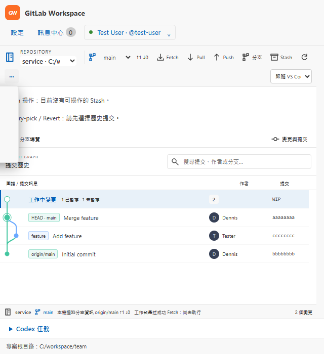
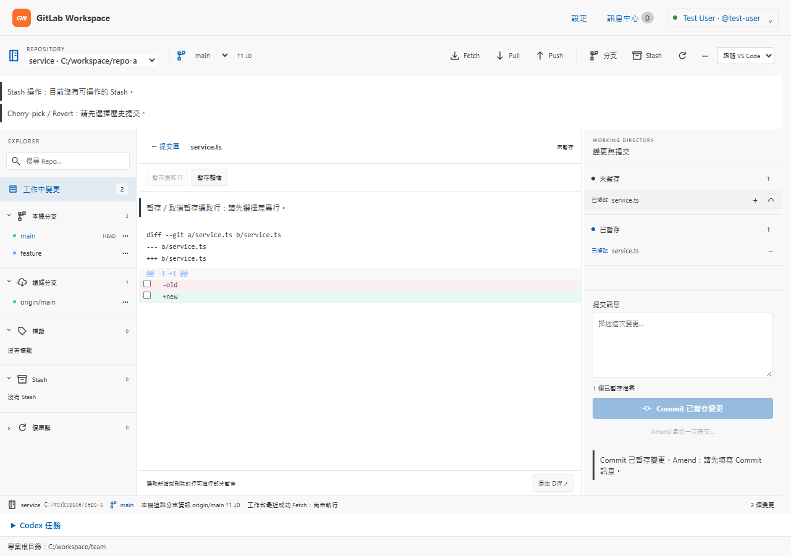
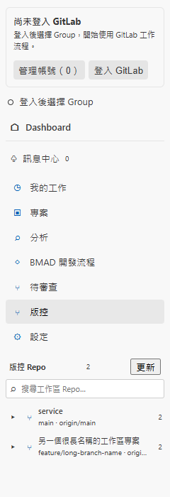

# GitLab Workspace：VS Code UI/UX 全面審查

本文件保留 `ddab4c2` 的原始審查與修改前證據，原始結論為 **Needs changes**。後續修復、測試、前後畫面與尚待人工驗收項目見 [實作與驗收紀錄](implementation-results.md)。下列 F01–F11 與檢核表描述基準版本，不代表修復後狀態。

審查日期：2026-11-05（Asia/Taipei）。基準：`main`／`ddab4c2`，Extension `0.39.0`，宣告最低 VS Code `1.90.0`。本次交付包括本報告、[實作方案](implementation-plan.md)、重現程式及證據；產品功能的修改列於實作方案。

## 審查範圍與證據強度

已檢查 `package.json` contributions／activation／capabilities、Extension 啟用與命令註冊、Host 與 Webview 通訊、Preact／Vite 介面、樣式、工作區與帳號邊界、測試及 `.vscode` F5 設定。依指定主控 Skill，亦使用 architecture、webview-design、webview-security、accessibility 與 ux-review 的檢核要求。

| 介面 | 本次檢查方式 | 主要位置 |
| --- | --- | --- |
| Activity Bar／工作台導覽／Repo 側欄 | Manifest、Host、鍵盤抽樣、240／320px 正式 bundle 渲染 | `package.json`、`src/quickActionsView.ts`、`src/webview/quick-actions.*` |
| Dashboard／遠端專案／離線本機 Repo | 正式 bundle、假資料截圖、既有行為測試 | `dashboard.tsx`、`LocalRepositoriesPanel.tsx` |
| 我的工作／Issue 詳情／關聯圖譜 | 原始碼、權限不足截圖、圖譜 Chromium accessibility tree、既有測試 | `dashboard.tsx`、`main.tsx`、`IssueGraph.tsx` |
| Skills／Wiki／Reviewer／BMAD | 原始碼、入口與產物狀態渲染、既有行為測試 | `SkillsGuide.tsx`、`ReviewSessions.tsx`、`BmadPanel.tsx` |
| 待審查 MR | 詳情與分頁渲染、分頁語意檢查、既有行為測試 | `dashboard.tsx` |
| Git 工作台／Diff／進階操作 | 原始碼、Light／HC 類別渲染、640px 選單操作、計算後色彩 | `GitControlPanel.tsx`、`git-control-panel.css` |
| Codex 任務／對話／核准 | 正式 bundle 操作、草稿與回執探測、Host 單元測試 | `CodexPanel.tsx`、`src/codex/*` |
| 設定／登入／訊息中心／Log | 原始碼、抽屜焦點與 Escape 實測、既有登入與通知測試 | `AccountPanel.tsx`、`Notification*.tsx`、`extension.ts` |

本次瀏覽器探測使用正式建置產物、合成 Host 訊息與假 Repo；沒有連線真實 GitLab 或執行 Codex 任務。[probe-results.json](evidence/probe-results.json) 記錄瀏覽器版本、bundle SHA-256、24 筆觀察及各項限制，共輸出 21 張截圖。主題使用快取 VS Code 內附主題 JSON，加上明列的缺省色彩；不能取代真正 VS Code Theme Service、Windows 高對比、NVDA 或 200% zoom 驗收。

## 已有良好基礎

- Extension 按命令／檢視啟用；`activate()` 沒有自動為所有視窗開啟工作台。
- Webview 限定各自的建置資產目錄，具備 `default-src 'none'`、nonce、禁止 inline style 的 CSP；本次渲染場景未記錄 CSP violation。[VS Code Webview 安全指南](https://code.visualstudio.com/api/extension-guides/webview#security)
- Issue Markdown 經 DOMPurify，另處理外部連結與附件；不能僅因使用 `innerHTML`／`dangerouslySetInnerHTML` 就判定此處存在 XSS。
- 帳號憑證持久化使用 SecretStorage；登入失敗保留舊帳號，登出與移除的差異有文字說明。登入時的 Webview 邊界問題另列 F05。
- 已有工作區／Repo identity、scope epoch、操作回執、取消、待核對結果及避免重送機制；Git 與本機工具可離線使用。
- Skills、BMAD、設定分頁已有 roving tabindex 與方向鍵處理；抽屜具備焦點限制、Escape、關閉後還原焦點，今回抽樣通過。
- 大量清單具備虛擬化；圖譜有大型 Canvas 路徑與鍵盤選取。本次小型圖譜 3 個節點均出現在 Chromium accessibility tree，未據 `role="img"` 單獨判定節點不可讀。
- 動畫尊重 reduced motion；Log 使用原生 Output Channel，並由使用者明確開啟。

## 問題清單

P1：應優先修復的使用者資料、主要操作、可讀性或訊息邊界問題。P2：應在後續介面調整中完成的一致性、可及性與可發現性改善。本次確認 **4 項 P1、7 項 P2**；各項證據與限制如下。

| ID | 優先 | 問題 | 證據類型 | 實作批次 |
| --- | --- | --- | --- | --- |
| F01 | P1 | Codex 切換任務及送出失敗會清空草稿 | 瀏覽器重現 | A |
| F02 | P1 | 640px 編輯區的 Git 進階選單向左裁切 | 瀏覽器操作與座標 | B |
| F03 | P1 | Light 主題 Diff 區段標題對比約 1.96:1 | 計算後色彩與公式 | B |
| F04 | P1 | Dashboard 部分 payload 未驗證就到達 Host adapter | Host 入口探測 | A |
| F05 | P2 | PAT 在 Webview state／DOM／訊息中流轉 | 原始碼；本次 Skill 安全要求 | C |
| F06 | P2 | Issue／MR 分頁缺少 tab 與 panel 的完整關聯 | DOM 與原始碼 | B |
| F07 | P2 | Codex 回覆與互動缺少合適的無障礙摘要／定位 | DOM 與原始碼；讀屏待驗 | A |
| F08 | P2 | 設定抽屜混合持久設定、安裝狀態及帳號流程 | 官方規範與架構檢查 | C |
| F09 | P2 | 側欄導覽佔據主要空間，Repo 資料適合原生 View | 240／320px 渲染及選型檢查 | D |
| F10 | P2 | Command Palette 的「開啟 Issue 詳情」無參數時無效果 | 命令 handler 原始碼 | C |
| F11 | P2 | 圖示、文字密度與主要按鈕缺少共同規則 | CSS／TSX 與截圖 | B／D |

### F01：Codex 草稿遺失

位置：[CodexPanel.tsx](../../../src/webview/CodexPanel.tsx)，第 39、55、78–81 行。

輸入狀態只有一份 `text`；`select()` 直接 `setText('')`。送出 handler 不檢查 `post()` 結果，也未等待 Host 回執便清空輸入。

重現：

1. 在任務 A 輸入補充內容，切至 B 再回 A：草稿成為空字串。
2. 輸入並傳送，在 Host 尚未回覆時：輸入已清空。
3. 上一筆操作仍待處理時再輸入並傳送：第二筆被 action controller 阻擋，Host 收到的送出數仍為 1，第二份草稿仍被清空。

[瀏覽器紀錄](evidence/probe-results.json) 的 `codex-drafts-and-announcements` 保存以上三項結果。

修正：依 Host 提供的任務 identity 保存非敏感草稿；發送 API 回傳 `DispatchResult`；以 operation ID 綁定提交文字，僅在 Host 確認接受，且目前文字仍等於該次提交時清空。blocked／failed／unknown 保留內容並提供核對路徑。現有 Git Commit、Issue／MR 的回執處理可作為專案內參考。

### F02：Git 選單在窄編輯區裁切

位置：[git-control-panel.css](../../../src/webview/git-control-panel.css)，第 39–44、243–256 行；[GitControlPanel.tsx](../../../src/webview/GitControlPanel.tsx)，第 668 行附近。

在 640×700 的 viewport 開啟「遠端與進階操作」。工具列換行後，觸發點移到左側；選單仍固定 `right: 0`、`min-width: 185px`。5 個操作的左緣為 **−142px**，右緣只有 31px。父層的 overflow 使使用者只能看到選單邊緣。



修正：依可用空間選擇左／右對齊，將選單限制在工作台範圍；必要時使用工作台根層的 overlay。補 Escape、關閉後還原焦點、方向鍵與 viewport 邊界檢查。帳號選單本次 640px 開啟時未見同一裁切問題，勿一併改壞。

### F03：Diff 的語意色彩未完整跟隨主題

位置：[git-control-panel.css](../../../src/webview/git-control-panel.css)，第 170–172 行。

跟隨 VS Code 主題時，Diff hunk 仍使用固定 `#86b6fa`。Light Modern fixture 的計算後背景是 `#f8f8f8`，對比 **1.961:1**；這是約 11px 的實際資訊文字。新增／刪除背景也使用固定色彩混合。一般文字的 AA 對比基準為 4.5:1。[VS Code Webviews 主題要求](https://code.visualstudio.com/api/ux-guidelines/webviews)、[W3C 對比說明](https://www.w3.org/WAI/WCAG22/Understanding/contrast-minimum.html)



修正：hunk 前景使用可讀的主題 foreground／textLink token；新增、刪除改用 `diffEditor.inserted*`／`removed*` token，並保留 `+`／`-` 與文字。High Contrast 增加可辨識邊界與 focus，驗證 HC Light。品牌識別與圖譜分類色可保留用途，但不應承擔唯一語意。

### F04：Dashboard 缺少完整 runtime message schema

位置：[workspacePanel.ts](../../../src/workspace/workspacePanel.ts)，第 844–854、1300、1304 行；對照已有 validator 的 [quickActionsProtocol.ts](../../../src/workspace/quickActionsProtocol.ts)。

Dashboard 的入口確認 object／type 與部分操作 metadata 後，以 `as WorkspaceRequest` 轉型。這不會產生 runtime 驗證。個別 handler 有檢查，但覆蓋不一致。

[Host 探測](evidence/protocol-results.json) 經實際 `handleMessage()` 執行，使用記憶體中的 VS Code adapter：

- `{ type: 'copy', text: { invalid: '...' } }` 未被拒絕，object 到達 clipboard adapter。
- `{ type: 'selectProject', projectId: { invalid: '...' } }` 未被拒絕，object 到達 `globalState.update('gitlabWorkspace.selectedProjectId', ...)`。

探測沒有操作真實剪貼簿或持久設定，也沒有建立可利用攻擊的證據；它確認了 payload 邊界的缺口。

修正：在任何 action policy、操作紀錄或 service 呼叫前，驗證 allowlisted discriminated union、欄位型別／長度／數量／額外欄位。數字 ID 須為有效 safe integer，再確認屬於允許的 project／Repo scope。保留 service 的授權、路徑及 SHA 再驗證。這符合官方對 Webview 輸入處理與最小能力的要求。[Webview 安全指南](https://code.visualstudio.com/api/extension-guides/webview#security)

### F05：PAT 在 Webview 中流轉

位置：[AccountPanel.tsx](../../../src/webview/AccountPanel.tsx)，第 30、99、112 行附近；[workspaceProtocol.ts](../../../src/workspace/workspaceProtocol.ts) 的 `submitAccountLogin`。

PAT 存在 Preact state 與密碼輸入 DOM，經 `postMessage` 傳到 Host。程式會在送出／隱藏後清空，持久化也使用 SecretStorage；此次未觀察到已保存 Token 被回送 Webview 或寫入 localStorage。

不符合本次 [Webview security Skill](../../../.agents/skills/vscode-webview-security/SKILL.md) 的「秘密只存在 Host／SecretStorage，禁止放在 HTML、postMessage」要求。官方另建議使用原生能力，並避免以 Webview 建立 wizard。[VS Code Webviews](https://code.visualstudio.com/api/ux-guidelines/webviews)

修正：帳號與站台選擇使用 Quick Pick／Input Box；PAT 使用 Host 的 `showInputBox({ password: true })`。Webview 只發出「開始登入」意圖並接收安全的帳號摘要與結果。GitLab 的既有 HTTP 相容政策應保留現有警告與授權規則，無須藉本次 UI 調整擅自改變。

### F06：Issue／MR 分頁的語意關聯不完整

位置：[main.tsx](../../../src/webview/main.tsx)，第 1064 行附近；[dashboard.tsx](../../../src/webview/dashboard.tsx)，第 1242、1459–1487 行。

Issue 與 MR 的 tabs 有 `role="tab"`、`aria-selected`、roving tabindex 與方向鍵；但缺少 tab ID、`aria-controls` 和對應內容的 `role="tabpanel"`／`aria-labelledby`。另外，外層 `.page` 被標為未命名 tabpanel，卻沒有同文件內對應的 mode tab。

修正：建立共用 Tabs 元件，補齊雙向關聯；無可聚焦內容的 panel 提供合理 Tab 落點。整頁 mode 容器改成具名 section。沿用 Skills／BMAD 已有的正確關聯實作；遠端讀取昂貴時，方向鍵只移焦點、Enter／Space 才啟用。[W3C Tabs Pattern](https://www.w3.org/WAI/ARIA/apg/patterns/tabs/)

### F07：Codex 回覆與互動需要可操作的無障礙摘要

位置：[CodexPanel.tsx](../../../src/webview/CodexPanel.tsx)，第 49–51、62–84、107–117 行。

任務狀態有 `role="status"`，輸出有可聚焦區域與 label；輸出內容、核准要求本身沒有新的可訪問摘要。互動到達只展開 details，缺少明確「前往待回覆要求」入口與互動區的 Repo／範圍摘要。實際 NVDA 朗讀結果仍待驗，不能宣稱所有訊息均無法被讀取。

修正：建立獨立、低頻率的 polite 摘要，只在完整回覆／等待互動／完成／失敗時更新；不要逐 token 朗讀。增加跳至最新回覆、複製回覆、前往待回覆要求。核准區緊鄰顯示 Host 驗證過的 Repo、action、scope；背景任務不搶走編輯器焦點。[VS Code Webviews 可及性要求](https://code.visualstudio.com/api/ux-guidelines/webviews)、[VS Code Accessibility](https://code.visualstudio.com/docs/configure/accessibility/accessibility)

### F08：持久設定與工作流程狀態需要分工

位置：[dashboard.tsx](../../../src/webview/dashboard.tsx)，`ToolDrawer` 第 1549–1666 行；[package.json](../../../package.json) 的 `contributes.configuration`。

抽屜混合共用根目錄、WorkflowKit 來源／安裝／診斷、Codex 設定與帳號管理。使用者可能不知道原生 Settings 與這個「設定」各自能修改什麼。官方明確要求使用 Settings UI，避免自行建立設定 Webview。[VS Code Settings](https://code.visualstudio.com/api/ux-guidelines/settings)

修正：持久設定導向原生 Settings 的精確設定 ID；WorkflowKit 安裝／更新／相容性保留為任務詳情，改名「工具與環境」。帳號摘要可在 Webview 顯示；登入與機密輸入依 F05 原生化。原生 Settings 不存 Token。

### F09：側欄應優先展示工作資料

位置：[quick-actions.tsx](../../../src/webview/quick-actions.tsx) 的 destinations 與導覽 render；[quick-actions.css](../../../src/webview/quick-actions.css)；Manifest 的單一 Webview View。

240／320px 渲染無水平溢出；但登入卡、Dashboard、訊息中心、6 個工作入口及設定，使 Repo 區分別從約 **504／487px** 才開始。每列與展開鈕都是獨立 Tab 落點，資料導覽與原生 Explorer／SCM 的操作模型不同。



修正：在既有 Container 內逐步換成原生 Repo／工作項目 View，動作放 view title／context menu／Command Palette，空白時用 `viewsWelcome`。Tree item 應代表 Repo、Issue、MR 等資料；不要把「分析」「設定」等動作改成假 Tree Item 按鈕。此 Container 現有 Repo 資料，並非 Activity Bar 點擊即直接開 Panel；本報告不把它判成官方禁止的直接 launcher 行為。[VS Code Views](https://code.visualstudio.com/api/ux-guidelines/views)、[Activity Bar](https://code.visualstudio.com/api/ux-guidelines/activity-bar)

### F10：無參數的 Issue 命令沒有使用者路徑

位置：[extension.ts](../../../src/extension.ts)，`gitlabWorkspace.openIssue` handler；[package.json](../../../package.json) 的 commands／commandPalette。

命令預設出現在 Palette，但 handler 僅在 `item?.issue` 存在時執行。Palette 呼叫沒有 Tree item 參數，這條路徑會直接結束。此次未在真實 VS Code Palette 手動操作，判斷來自 handler 的明確分支。

修正：無參數時 Quick Pick 選 Issue／進入我的工作；或將它明確標為只供資料項目使用並隱藏於 Palette，另提供真正可獨立使用的「選擇並開啟 Issue…」。命令使用 `category` 統一群組、補明確動詞，依工作區／登入狀態設定合理 enablement。[Command Palette](https://code.visualstudio.com/api/ux-guidelines/command-palette)

### F11：圖示、密度與主要動作需統一

位置：[quick-actions.tsx](../../../src/webview/quick-actions.tsx) 的 `◷／▣／⌕／◇／⑂` 等圖示；[git-control-panel.css](../../../src/webview/git-control-panel.css) 第 63、95、108、255 行；[SkillsGuide.tsx](../../../src/webview/SkillsGuide.tsx) 第 177 行附近；[BmadPanel.tsx](../../../src/webview/BmadPanel.tsx) 第 175 行附近。

側欄使用 Unicode 幾何圖示，Git 使用另一套自繪 SVG；部分實際資訊字體固定為 8–11px，窄版 eyebrow 降至 7px。Skills／BMAD 同時把「使用 Codex 執行」與「複製提示詞」設為 primary。操作條件提示又會在 Git 頂部佔據多列。

修正：導覽及常見操作使用本地打包 Codicons；以 `--vscode-font-size` 建立共同字級，避免靠縮字容納更多內容。每個任務保留一個 primary，複製降為 secondary。一般條件提示就近顯示，將當下無關的進階條件收合，保留可聚焦說明與 `aria-describedby`。官方沒有要求本報告建議的特定最小 px 值；字級調整是本案設計建議。[VS Code Views](https://code.visualstudio.com/api/ux-guidelines/views)、[Product icons](https://code.visualstudio.com/api/references/icons-in-labels)

## 驗收結果

下表依 Skill quality gates。PASS 僅限明列的檢查範圍。

| Gate | 結果 | 證據與限制 |
| --- | --- | --- |
| UX-01 原生／Webview 選型 | FAIL | F08／F09；細節編輯、圖譜、Diff 與聊天仍有 Webview 理由 |
| UX-02 scope／Repo 隔離（單元覆蓋） | PASS | workspace lifecycle、project root、repository selection、Codex 等指定測試；目錄別名除外 |
| UX-02 真實多視窗／SSH／WSL | NOT TESTED | 沒有以實際 Host、遠端 filesystem 驗收；目前非 file URI 會被視為本機能力不足 |
| UX-03 狀態與復原 | FAIL | 多數清單／離線／待核對狀態已有覆蓋；F01 的 Codex 草稿復原失敗 |
| UX-04 側欄 240／320px | PASS | fixture 無水平溢出；資料可見性問題見 F09 |
| UX-04 窄編輯區 640px | FAIL | F02，Git 選單 5 個操作向左裁切 |
| UX-05 主題可讀性 | FAIL | F03 的 Light Diff 對比約 1.96:1 |
| UX-05 真實 HC／HC Light／200% zoom | NOT TESTED | 主題類別渲染與 viewport 縮放不等於這些人工驗收 |
| UX-06 完整主要任務鍵盤操作 | NOT TESTED | 已抽樣側欄 Tab 與抽屜焦點；未完成真實 Host 全流程 |
| UX-07 ARIA／焦點 | FAIL | F06／F07；設定抽屜關閉與還原焦點的抽樣通過 |
| UX-07 NVDA | NOT TESTED | Chromium AX tree 可供檢查，不能等同讀屏測試 |
| SEC-01 CSP／資源範圍 | PASS | 原始碼、既有測試與此次正式 bundle 渲染；原生 Webview 仍須人工驗收 |
| SEC-02 Host message schema | FAIL | F04 的 malformed payload 到達 adapter |
| SEC-02 Markdown 清理（既有測試） | PASS | DOMPurify、style／事件屬性等既有行為測試 |
| SEC-03 Secrets 邊界 | FAIL | F05，依指定 Skill 的 Host-only 要求；持久化採 SecretStorage |
| SEC-04 Trust／危險操作（程式檢查） | PASS | untrusted unsupported、virtual limited、危險 Git／MR 原生確認與 scope 檢查已有實作 |
| SEC-04 真實 Restricted Mode／確認視窗 | NOT TESTED | 未執行本次原生 Host 的 Trust 與真實危險操作驗收 |
| QA-01 Lint／compile／前端型別與建置 | PASS | [build-timings.json](evidence/build-timings.json) |
| QA-01 行為測試 | PASS | Node 231／231；Issue 29 情境／136 步；登入重跑 10 情境／35 步 |
| QA-01 指定單元測試整組 | FAIL | 107 項中 106 通過、1 項 Windows symlink `EPERM`，見下節 |
| QA-02 F5 Extension Development Host | NOT TESTED | 已查 launch／tasks，沒有宣稱實際 F5 通過 |
| QA-03 hide／reload／dispose／切換（單元覆蓋） | PASS | workspace lifecycle／startup 等指定測試 |
| QA-03 真實 Host 重開與失連線 | NOT TESTED | 需實際 Host 與服務驗收 |
| Demo 連線標示 | N/A | 正式產品未識別出 Demo 服務模式；本次 probe 的假資料僅用於測試 |

## 測試紀錄與限制

`npm.cmd run prepare:validation` 完成 ESLint 零警告、Host TypeScript、Webview 型別及 Dashboard／Sidebar／Issue test bundle 建置。

`npm.cmd run test:behavior:prepared` 的 Node 與 Issue 情境通過；原執行的登入情境因 sandbox 暫存目錄 atomic rename `EPERM` 失敗，原失敗仍保留在 [behavior-timings.json](evidence/behavior-timings.json)。將程序的 `TEMP`／`TMP` 導向工作區內隔離目錄後，單獨重跑登入情境 **10／10 通過**，見 [connect-tests.log](evidence/connect-tests.log)。[Node 行為結果](evidence/behavior-node.log)、[Issue 情境結果](evidence/behavior-issues.log) 可逐項查閱。

16 個指定單元檔案共 **107 項，106 通過，1 失敗**。將 Temp 放入 Git checkout 後，需額外設定 `GIT_CEILING_DIRECTORIES` 避免 fixture 誤認父 Repo；最後剩下目錄別名測試的 Windows `symlink EPERM`。[完整結果](evidence/unit-tests-isolated.log)。該項不能標成通過，也不據此認定產品有目錄別名回歸。未執行完整 `npm test`、Release 打包、真實 GitLab／Codex、F5／NVDA／跨視窗及實際 zoom。

瀏覽器與 Host 探測的重跑方式：

```powershell
npm.cmd run prepare:validation
node docs/work/work-20261105-vscode-ux-review/probe.mjs
node docs/work/work-20261105-vscode-ux-review/protocol-probe.cjs
```

瀏覽器探測攔截並從本機檔案回應所有頁面資產，不需要 localhost server 或外部連線。可透過 `CHROME_PATH`／`VSCODE_THEME_ROOT` 指定執行檔與主題目錄。這些程式記錄觀察結果；應依 [實作方案的驗收條件](implementation-plan.md) 判斷修改是否真正解決問題。
