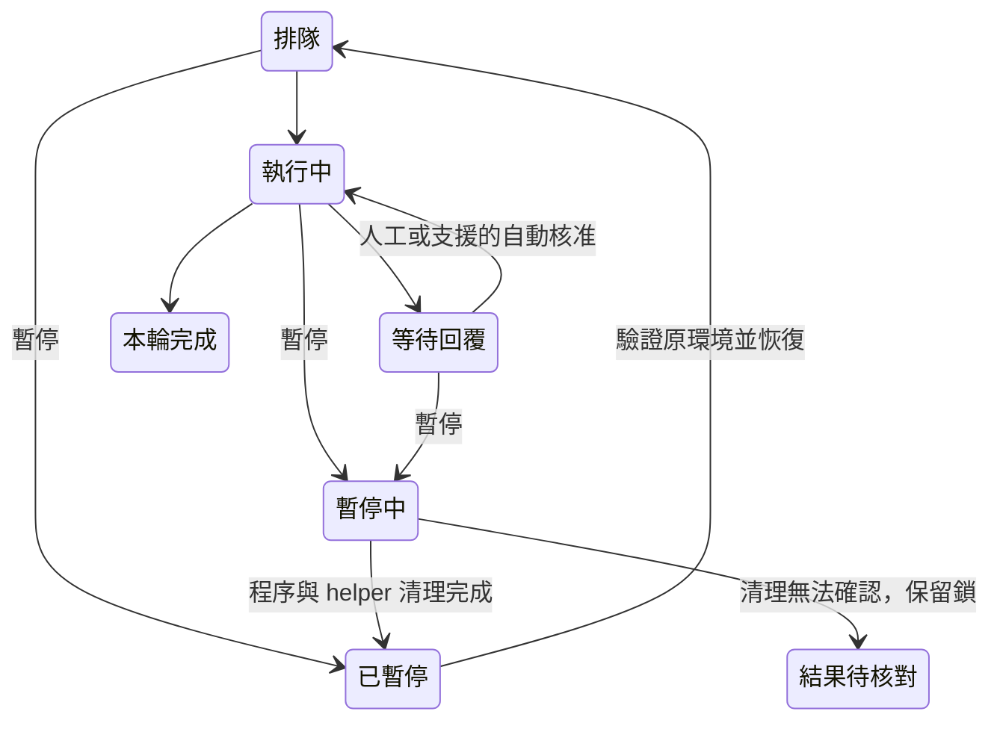

# Codex 統一管理與 Auto-Accept 驗收

日期：2026-11-06。實作維持本擴充功能的既有任務來源、Codex sandbox 與審查身分；新增獨立 Codex 頁、逐任務暫停／恢復、僅刪管理紀錄與逐任務 Auto-Accept。

## 介面與資料流

| 表面 | 用途與選擇理由 |
| --- | --- |
| 原工作台 Webview | 任務清單、連續執行輸出、核准表單與接續輸入共用同一頁；沿用既有 Preact 與公開 Webview API |
| 原生命令 | `gitlabWorkspace.openCodexMode` 可從命令選單進入 |
| 原生確認視窗 | 刪除管理紀錄前說明保留 Codex 對話、檔案與報告 |

原功能頁 → ActionController／操作收據 → WorkspacePanel → CodexBridge → App Server。Host 將任務、輸出與互動投影送回常駐的 Webview controller，再呈現於 Codex 頁；原始 RPC 不進 Webview。

Auto-Accept 儲存在 Host 記憶體，預設 OFF，重建 Webview 不重設；重新載入 Host 才回到 OFF。核准透過同一回覆流程送出，限定目前 task/thread/turn/transport request；一般提問、選擇、MCP 表單及登入保留人工處理。

刪除以 task 控制鎖序列化，先建立持久刪除標記再移除管理紀錄。儲存、重載、輸出定時器與歷史回覆均處理已刪任務，防止其他視窗或延遲事件重新呈現紀錄。

恢復期間以 Host 的控制狀態保護記憶體紀錄，避免檔案監聽器在落盤前將舊的已暫停狀態寫回。真實 Wiki 暫停／恢復測試曾重現此競態，已加入延遲儲存加上監聽器重載的確定性回歸測試。核准送出後若連線中斷，也會關閉 Auto-Accept 並保留結果待核對。

一般任務恢復會重述原始目標；審查 request ID 與固定證據指示只套用審查任務。CLI 0.166.0 的空白 thread 在第一則使用者訊息保存前會拒絕 `thread/turns/list`，已透過不呼叫模型的原生 API probe 確認；介面延後新任務的自動歷史讀取，避免顯示這項預期的暫態錯誤。

同一強度的 reviewer 暫停後沿用原 reviewer thread，升級強度時才依原 Routing 流程建立新 reviewer 上下文。若在第一回合送出前暫停，不保留尚未建立持久對話的空白 thread；恢復後只送出一次原始工作。Host 會重播已載入的歷史分頁及最舊游標，讓 Webview 重建後還原閱讀位置；刪除紀錄時一併清除這份快取。

## 驗證結果

| 項目 | 結果 | 證據與限制 |
| --- | --- | --- |
| 型別、Lint、Webview 建置 | PASS | 已執行 TypeScript 檢查、ESLint 與 Vite 建置；完整流水線另記錄於下方 |
| 任務生命週期及自動核准 | PASS | 最終程式碼 162 項相關離線測試全部通過，包含單一任務暫停、恢復時的監聽器競態、排隊續跑、原對話恢復、helper 清理失敗後持久隔離鎖、刪除標記、核准去重、權限範圍與錯誤時關閉 |
| UI 行為 | PASS | Codex 相關及八模式導覽共 9 項 browser DOM 回歸通過，覆蓋草稿／收據、歷史讀取時機、時間線、閱讀位置、較早分頁還原、刪除與可及性摘要 |
| 主題與尺寸 | PASS（fixture） | Chromium 以 VS Code theme tokens 驗證 Light、Dark、High Contrast、320px、200% 放大；無根節點或 console 橫向溢出，無 page error；畫面人工檢查確認無輸出卡片 |
| 鍵盤主路徑 | PASS（fixture） | Chromium Tab 到達暫停與 Auto-Accept，Space 切換開關，輸入補充內容並以 Tab／Enter 送出及接收回覆；量測見 visual-checks.json |
| CSP／安全訊息 | PASS（自動化） | restrictive CSP、文字節點輸出、Host 訊息 schema、Workspace Trust 與本機能力檢查通過；原生 Host 17 項、單元 1,114 項及 UI 行為 241 項均通過 |
| 真實 App Server 環境 | PASS | CLI 0.166.0；account/read、Windows sandbox readiness 與管理政策檢查均 ready；此步未呼叫模型 |
| 完整 `npm test` 測試階段 | PASS；整體命令非 0 | Extension Host 17 項（4 項預期 pending）、Trust、unit 1,114 項（3 skip）、browser DOM 241 項、Cucumber 與發布工具，以及固定套件整合 16 項均通過。最後封裝因測試期間更新原始碼而回報 stale preparation，命令以 1 結束；最終程式碼另通過 162 項離線及 9 項 UI 回歸 |
| 最終 VSIX | PASS | 最終原始碼另執行 `npm run package`，Lint、編譯、Webview 建置、VSIX 封裝及內容驗證全部通過；run：`2026-11-06T05-59-46.581Z-10468` |
| 真實四流程冒煙 | PASS | 候選 VSIX 在獨立 Repo、VS Code 設定檔與擴充功能目錄完成 Wiki、MergeReviewer、ReleaseReviewer、BMAD；兩種審查有原生報告、BMAD 有已保存文件。最終 VSIX 再獨立通過 Wiki 的 Auto-Accept 開關、暫停清理、同對話恢復、原始問題回答及歷史收據完成檢查。三種其他流程未在最後一次封裝重跑；最後調整的 reviewer 對話恢復及歷史快取另有離線回歸 |
| NVDA 讀屏器人工聆聽 | NOT TESTED | 已驗證 ARIA、polite 摘要與不逐字播報的 DOM 行為，未將它視為人工讀屏驗收 |

暫存圖像與量測位於 `.tmp/codex-visual`；完整驗證日誌位於 `.gitlab-workspace-validation/runs`，均為本機可再生證據。

真實四流程證據：`.tmp/codex-live-5pUF7m/results.json`；最終包 Wiki 證據：`.tmp/codex-live-9k5fTM/results.json`。去除完整任務內容的摘要見 [live-checks.json](live-checks.json)，視覺與鍵盤量測見 [visual-checks.json](visual-checks.json)。真實測試使用 CLI 0.166.0、VS Code 1.145.1 與固定 WorkflowKit 1.3.5 fixture。

## 交付判定

可交付。未發現阻擋本次功能的已知問題；本紀錄不宣稱人工讀屏驗收完成，也不將跨候選包的四流程結果稱為同一最終包的完整重跑。既有 v1 任務格式仍可讀取，沒有加入執行期相依套件。

安裝包：`dist/gitlab-workspace-0.40.0.vsix`。SHA-256：`a32c716ae99b0a5064767dc9f688080424b6ec10fc4ba9969fcf176e84284c15`。

## 重現

- `npm test`：完整自動化與打包。Windows 需在允許本機暫存檔 rename 及獨立 VS Code 的環境執行。
- `npm run test:codex:live`：以已登入 Codex 驗證 Wiki、MergeReviewer、ReleaseReviewer、BMAD；會使用模型額度。
- 原生工作台人工檢查：由原功能頁建立任務 → Codex 連續輸出 → 開關 Auto-Accept → 暫停 → 恢復 → 完成後刪除紀錄 → 核對產生的檔案與報告仍存在。
