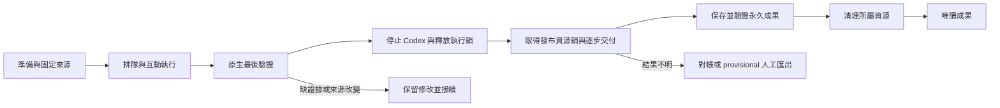

# 互動式一鍵執行、自動交付與人工備援

日期：2026-11-13。範圍：GitLab Workspace VS Code 擴充功能；保留現有 Launch Coordinator、App Server stdio、排程、OperationTracker、GitLabClient 與清理 journal。

## 實作結果

| 功能 | 行為與邊界 |
| --- | --- |
| 一鍵啟動 | 首次保存 Repo、模型、測試、必要／額外 Skills；有效偏好可直接檢查並執行。來源變更須確認，MR 審查／修正偏好分開。 |
| Group 分析 | 本機離線使用目前 Group 的 Repo；固定提交 archive 排除 dirty 檔。依 BMAD 輸出設定產生 SPEC、牌卡及逐 Repo/SHA 證據，使用者自行開 Issue。 |
| Issue | managed worktree 實作與原生最後驗證；普通 commit/push、自有 Draft MR 與 Issue 回覆。目標前進保留原基準並標示驗證版本。 |
| Wiki／MR | Wiki 逐頁對帳；審查固定來源／目標；討論修正核對選定討論並推送真正的 fork source project。 |
| 互動 | 問答、MCP 表單、插話、暫停與接續保留；讀實際 cwd 的有效設定，核准只使用原生選項與範圍，Auto-Accept 預設關閉。 |
| 交付恢復 | 逐步保存 prepared/sending/confirmed/uncertain；重試不重跑模型。未知附件不盲目重傳，已關閉 MR 不重建。交付意圖鎖定後，新要求另存後續草稿。 |
| 人工接手 | 先停止自動處理；完整成果可還原至新的人工 worktree。發布不明可匯出 provisional 包，保留原環境與待核對操作。 |
| 清理 | 保存成果並實際驗證還原後，才清已確認所有權的對話、專用暫存、worktree、草稿及指定 SHA 的臨時 refs。原 Repo、成果分支、人工目錄與共用安裝保留。 |

自動交付目前預設關閉，可由使用者明確勾選並保存。尚未完成真實模型／GitLab 的隔離環境端到端驗收，不把本機測試視為已完成該驗收，也不開啟新的自動交付預設。

## 資料及程序保護

- 任務採 v3，清理 journal 採 v2，保留舊歷史與升級備份；舊 Host 對新資料拒絕管理。closing、逐 thread 刪除確認與 tombstone 防止崩潰或晚到寫入復活任務。
- 永久成果包含需求、Skills 指紋、測試命令／cwd／時間／退出碼／成果指紋、待辦、發布收據、完整二進位 patch 與檔案 mode/hash 清單。不依賴舊 thread、runtime 或原生 request。
- Group 各 Repo 的原位置及固定 SHA 由 Host 另存 `documents/repositories.json`，即使中斷時模型尚未寫入 SPEC／sources.json，仍能在原環境刪除後讀取與匯出基準。
- 首版完整成果上限 128 MiB／50,000 個檔案。不支援的 symlink/gitlink、缺基準物件、超限或還原失敗均保留原環境；程式還原仍需要對應 Repo 與基準提交。
- 人工目錄不列入原任務清理。原 Repo 不存在時，成果仍可閱讀與匯出。舊歷史未有原生 thread 建立證據者，不推測對話所有權或掃描其他 Codex 對話。
- 不自動 merge、force push、rebase、關閉 Issue 或解決討論。

## 連線與啟動方式

確認並修正了「產品事件回呼例外被視為 JSON-RPC 通訊損壞」的誤斷線路徑，並把預設 turn/start 等待延長到 90 秒，保留有上限且遮蔽憑證的 stderr 尾端、結束碼及 signal。這些是程式路徑修正與診斷改善，不能單憑靜態檢視推定使用者每次斷線的實際原因。

自動流程仍由 VS Code Host 管理 App Server，執行期間需保持 VS Code 開啟。人工備援可以開新的資料夾與 PowerShell／Codex CLI 對話；不自動向使用者終端貼入命令，也不依賴原對話續作。

## UI／UX 驗收

沿用現有 rich conversation Webview；Repo／目錄／本機連線與還原位置使用原生 QuickPick／dialog。無新增 contribution 或通用快取／排程框架。

| Gate | 結果與證據範圍 |
| --- | --- |
| 原生一致性與任務流 | 沿用現有工作台、原生選擇器及操作追蹤；失敗、離線、部分交付與人工接手有明確入口。 |
| 主題／窄版／等效縮放 | PASS（renderer）：最終磁碟來源 80/80；四主題的 320 CSS px Group SHA 均為 0 溢出。見 [UI 摘要](evidence/ui-summary.json)、[換行檢查](evidence/group-sha-wrap.json)。 |
| 鍵盤／焦點 | PASS（限定範圍）：80/80 主操作的鍵盤重入／Enter；展開後四主題 4/4 聚焦首個新增成果，背景更新不移焦點。見 [焦點檢查](evidence/pagination-focus.json)。未宣稱全控件完整 Tab 遍歷。 |
| 退休／晚到事件 | 新增 revisioned live card → results-only 與晚到 live card 拒絕回歸；原 thread 操作停用。 |
| CSP／訊息契約／Trust | 嚴格 Host validator、草稿 sanitizer、儲存驗證與既有 Workspace Trust；以 fixture 及真實 Host 測試驗證。 |
| 真實輔具／原生縮放 | NOT TESTED：螢幕閱讀器、Electron 原生縮放與 QuickPick 的系統視覺。renderer 的縮放為有效 viewport/device scale。 |

## 驗證紀錄

最終來源執行 `npm.cmd run test:ui` 成功，run ID 為 `2026-11-13T07-26-46.561Z-22584`，17 個階段退出碼皆為 0。見 [最終驗證紀錄](evidence/validation-ui.json)。

| 檢查 | 結果 |
| --- | --- |
| ESLint、Host／Webview 型別及打包 | PASS，無警告；dashboard 與測試 bundle 成功。 |
| 真實 VS Code 1.146.0 Host | 19 通過，4 個可選案例 pending；Workspace Trust 通過。 |
| 單元測試 | 1,473 個案例：1,470 通過、0 失敗、3 個 POSIX-only 案例在 Windows 跳過。 |
| Node 行為測試 | 331／331 通過。 |
| Issue／連線 Cucumber | 30／30 與 10／10 scenarios 通過；共 175 steps。 |
| Renderer 與發布工具 | Renderer 通過；Node 發布工具 68／68 通過。 |
| VSIX | package 與 verify-package 通過，版本 0.50.0；見 [大小及 SHA-256](evidence/package.json)。未安裝至使用者設定檔。 |
| UI 矩陣 | 80／80，詳細範圍與未測項目見上表。 |

此前完整 `npm.cmd test` 的 run `2026-11-13T05-10-18.263Z-20948` **未整輪成功**：兩個既有 Python WorkflowKit 升級／回復案例在固定的 180 秒子程序等待處逾時，原因未確定；其餘階段通過，包含真實 Host 的 WorkflowKit 安裝相容性。原案例、產品、fixture 與 timeout 都未修改，兩案分別單獨重試後通過（53.739 秒及 102.227 秒）。見 [完整嘗試](evidence/validation-full-attempt.json)、[重試紀錄](evidence/release-retries.json) 及對應 log。最終來源的 `test:ui` 不含這組 Python 發布整合測試，因此不將結果描述成最後一輪完整 `npm test` 全數通過。

另外以離線 App Server fixture 驗證事件回呼拋出例外後，下一個 JSON-RPC echo 仍成功，且產生 callback 類型診斷；未啟動模型或連線 GitLab。

判定：**Ready（本機實作與上述驗證範圍）**。真實模型／GitLab 的五類流程端到端、真實輔具與原生縮放仍為 NOT TESTED；完成隔離環境端到端驗收前，自動交付維持預設關閉。安裝新版後須重新載入所有相關 VS Code 視窗，避免舊 Host 與 v3 任務資料混用。
